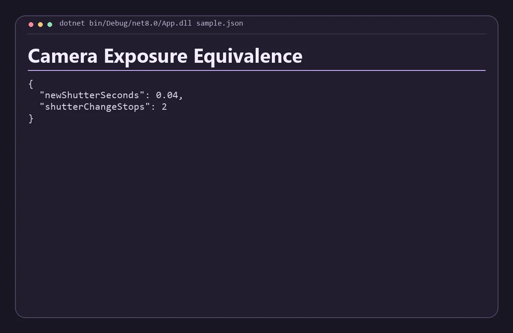

# Camera Exposure Equivalence

Calculate an equivalent shutter duration after changing aperture, ISO, and neutral-density filtration.



## Run

Install .NET 8 SDK and runtime. Run these commands from the repository root.

```sh
dotnet build --nologo
dotnet bin/Debug/net8.0/App.dll sample.json
```

Replace `sample.json` with a JSON file following the same structure. The app prints a JSON report to standard output.

Provide shutter duration in seconds, aperture as the f-number, and positive ISO values. Filter stops are the added neutral-density attenuation. Negative values represent removing a filter. The formula assumes linear exposure and omits motion blur and reciprocity effects.

## Verify

Run `python check.py` with Python 3.11 or newer after the build step when applicable. The check verifies the bundled scenario and confirms that an invalid input returns an error.
